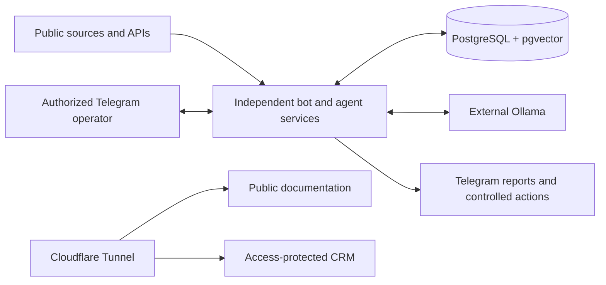

<div align="center">

# ◉ Watcher

### A private, self-hosted intelligence system operated from Telegram

**17 focused applications · one TypeScript monorepo · one PostgreSQL source of truth**

[Explore the docs](https://bots.vantuch.dev) · [Deploy Watcher](deploy/README.md) · [Configure the stack](deploy/ENVIRONMENT.md)

</div>

---

Watcher turns public sources, market data, documents, CRM records, and personal context into focused private workflows. Every bot owns its runtime boundary while sharing durable storage and carefully scoped workspace packages.

> Telegram is the operator interface. PostgreSQL holds durable state. Ollama provides optional local inference. Docker Compose runs the production stack on one Linux server.

## ✦ What lives here

| Area                    | Applications                                                                                                                                              | What they do                                                             |
| ----------------------- | --------------------------------------------------------------------------------------------------------------------------------------------------------- | ------------------------------------------------------------------------ |
| **Daily intelligence**  | [Briefing](apps/briefing-bot/README.md) · [News](apps/news-bot/README.md) · [Publications](apps/publications-bot/README.md)                               | Build personal briefings and monitor relevant public information.        |
| **Markets & decisions** | [Stocks](apps/stocks-bot/README.md) · [Reality](apps/reality-bot/README.md) · [Transport](apps/transport-bot/README.md)                                   | Track opportunities, evaluate evidence, and support bounded decisions.   |
| **Business & career**   | [Sales](apps/sales-bot/README.md) · [Networking](apps/networking-bot/README.md) · [Jobs](apps/jobs-bot/README.md) · [Socials](apps/socials-bot/README.md) | Research leads, manage relationships, discover roles, and plan content.  |
| **Research & learning** | [OSINT](apps/osint-bot/README.md) · [Study](apps/study-bot/README.md)                                                                                     | Produce provenance-backed investigations and learning material.          |
| **Local discovery**     | [Brno Events](apps/brno-events-agent/README.md) · [MU Clubs](apps/mu-clubs-monitor/README.md)                                                             | Monitor events and university communities without duplicating delivery.  |
| **Platform operations** | [Maintenance](apps/maintenance-agent/README.md) · [Twenty Sales App](apps/twenty-sales-app/README.md) · [Documentation](apps/docs/README.md)              | Keep services healthy, extend CRM workflows, and publish versioned docs. |

## ⟶ How Watcher works



The boundaries are deliberate:

- each runnable app under `apps/` owns its process lifecycle, scheduling, readiness, and shutdown;
- shared packages exist only for behavior with concrete consumers;
- PostgreSQL constraints and persisted claims provide idempotency and overlap protection;
- independent sources fail in isolation instead of cancelling an entire run;
- every Telegram command, callback, upload, and free-text workflow is private by default;
- research and generated drafts never imply permission to contact, publish, trade, or perform another external action.

## ⚡ Start locally

### Requirements

| Runtime    | Version or role                                |
| ---------- | ---------------------------------------------- |
| Node.js    | 24 or newer                                    |
| pnpm       | 11                                             |
| PostgreSQL | 16 with pgvector                               |
| Docker     | Docker Compose for the production-like stack   |
| Ollama     | External and optional for LLM-enabled features |

```bash
pnpm install --frozen-lockfile
pnpm db:generate
pnpm db:deploy
pnpm build
```

Start one application or the documentation site:

```bash
pnpm --filter @watcher/briefing-bot dev
pnpm docs:dev
```

Run the Compose stack with a private environment file:

```bash
WATCHER_ENV_FILE=/absolute/path/to/watcher.env docker compose up -d
```

Do not place secrets in `.env.example`. The complete inventory is in [deploy/ENVIRONMENT.md](deploy/ENVIRONMENT.md), with safe service presets in [`deploy/presets`](deploy/presets).

## ✓ Quality contract

Every completed change is expected to pass the same root gates used by CI:

```bash
pnpm format:check
pnpm lint
pnpm typecheck
pnpm test
pnpm build
```

Also run `pnpm db:validate` after Prisma changes and `docker compose config --quiet` after Compose changes.

## ◫ Workspace map

```text
apps/       independently deployable bots, agents, CRM extension, and docs
packages/   shared database, source, Telegram, LLM, and domain capabilities
deploy/     production scripts, environment contracts, and safe presets
docs/       focused architecture and operational notes
```

| Package                    | Shared responsibility                                                       |
| -------------------------- | --------------------------------------------------------------------------- |
| `@watcher/core`            | Pipeline contracts, scheduling, networking, and common types                |
| `@watcher/database`        | Prisma schema, migrations, repositories, and persisted configuration        |
| `@watcher/sources`         | Reusable adapters, safe HTTP behavior, and caching                          |
| `@watcher/telegram`        | Authorization, keyboards, rendering, and message splitting                  |
| `@watcher/llm`             | Ollama requests, structured parsing, validation, and inference coordination |
| `@watcher/observability`   | Run, source, feedback, and resource telemetry                               |
| `@watcher/contact-network` | Shared contact and business-card workflows                                  |
| `@watcher/google-calendar` | Encrypted Calendar OAuth and event operations                               |
| `@watcher/jobs`            | Job discovery, normalization, HTTP policy, and deterministic matching       |
| `@watcher/notion`          | Shared retrying Notion API client                                           |

## ⛭ Production shape

Production publishes one immutable image per commit. Docker Compose runs each app as a separate service, with private databases and caches. Runtime secrets stay in mode-`0600` files under `deploy/runtime`; application secrets are never uploaded by CI.

Cloudflared connects approved HTTP origins through the external `vantuch` Docker network and the `vantuch server` tunnel:

- public documentation: [bots.vantuch.dev](https://bots.vantuch.dev)
- Twenty CRM: protected by Cloudflare Access
- PostgreSQL, Redis, and internal readiness endpoints: private
- Ollama: external to the Compose stack

Read the [production guide](deploy/README.md) and [Cloudflare tunnel setup](deploy/README.md#cloudflare-tunnel-origins) before publishing services.

## ↗ Go deeper

- [Versioned documentation website](apps/docs/README.md)
- [Morning briefing architecture](docs/morning-briefing-architecture.md)
- [Evening journal workflow](docs/evening-journal.md)
- [Stock intelligence](docs/stock-intelligence-phase-1.md)
- [OSINT architecture](docs/osint-architecture.md)
- [Repository rules and completion criteria](AGENTS.md)

---

<div align="center">

Built for one operator, one server, and workflows that remain inspectable.

</div>
