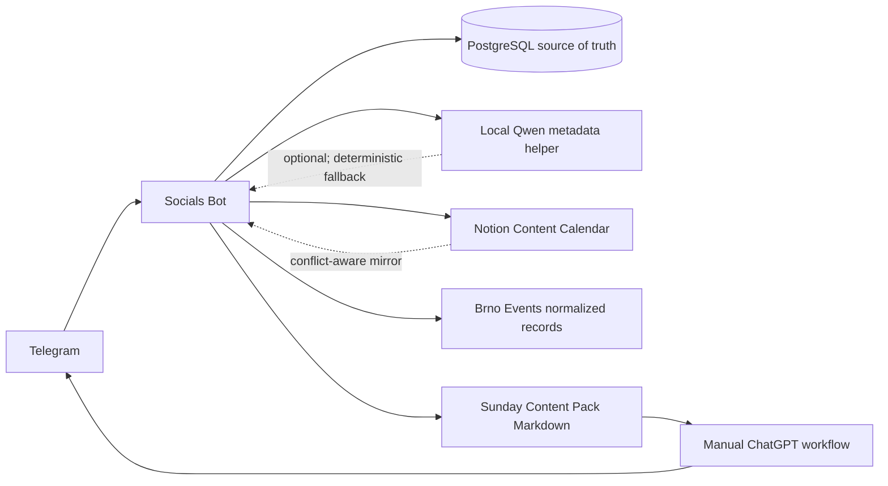
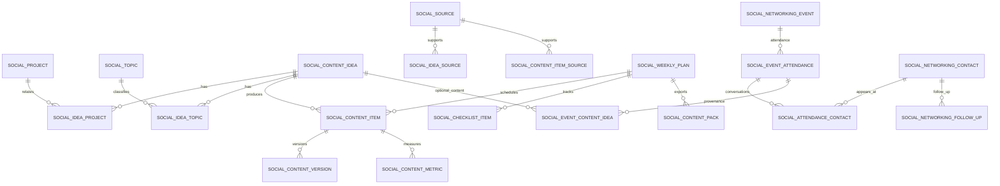
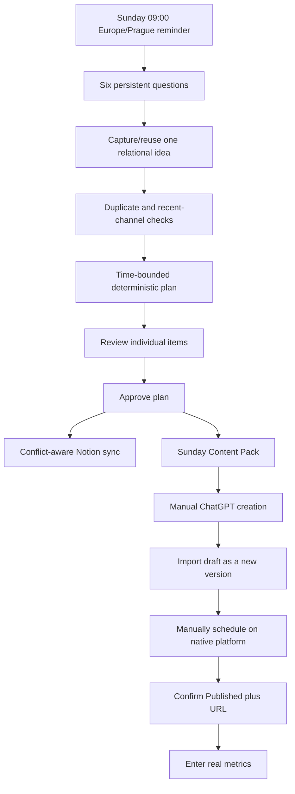

# Socials Bot

Socials Bot is a private Czech Telegram workflow for personal-brand content planning and genuine professional networking. PostgreSQL is authoritative, Telegram is the interaction layer, Notion is an optional editorial mirror, and ChatGPT remains a manual high-quality writing step. The bot never publishes to LinkedIn, Instagram, the website, or a newsletter.

## Architecture



The main service boundaries are:

- `SocialsStore`: ownership-scoped persistence, transactions, versions, plans, reminders, networking, and external identities.
- `SocialsService`: idea capture, deterministic planning, pack export, analytics, event import, and optional Notion sync.
- `LightweightIdeaClassifier`: deterministic Czech keyword/project matching with a small, schema-validated Qwen request as an optional enhancement.
- `SocialsScheduler`: idempotent Sunday planning, Monday networking, pre-event, and post-event jobs.
- `SocialNotionSync`: stable page identities, local hashes, Notion imports, and two-sided conflict detection.

## Relational model



Projects marked `PRIVATE` or `CONFIDENTIAL` are excluded from ChatGPT prompts and Notion project labels. Content versions are append-only. A scheduled timestamp never changes a content item to `PUBLISHED`; publication requires a manual status change with a URL.

## Telegram commands

| Command                | Behavior                                                                   |
| ---------------------- | -------------------------------------------------------------------------- |
| `/socials`             | Main inline menu.                                                          |
| `/socials_plan`        | Start or view the persistent six-question planning flow.                   |
| `/socials_add [text]`  | Capture one idea, relate topics/projects, and show similarity warnings.    |
| `/socials_ideas`       | Browse the idea backlog.                                                   |
| `/socials_projects`    | Browse projects or add one with its description and visibility.            |
| `/socials_topics`      | Browse reusable topics and pillars.                                        |
| `/socials_week`        | Show the next editorial week, explanations, warnings, and checklist.       |
| `/socials_pack`        | Download an idempotent versioned Markdown Content Pack.                    |
| `/socials_drafts`      | Select an item and paste/upload a new draft version.                       |
| `/socials_status`      | Show production progress; `ID STATUS [published URL]` updates it manually. |
| `/socials_history`     | Published content and URLs.                                                |
| `/socials_analytics`   | Correlation-only review and manual metric entry.                           |
| `/socials_networking`  | Selected events, confirmed attendance, and fresh recommendations.          |
| `/socials_events`      | Upcoming verified/unverified event records.                                |
| `/socials_events_free` | Only events explicitly marked free by a source.                            |
| `/socials_event_add`   | Add a manually verified event record and official source URL.              |
| `/socials_sources`     | Operational, aggregated, and manual-only source registry.                  |
| `/socials_contacts`    | Private contacts; supports `add`, `followup`, `done`, and `delete`.        |

Every command and callback passes the shared Telegram allowlist middleware. Sessions, answers, content, and callback-owned records are scoped to the Telegram user ID.

Argument examples:

```text
/socials_projects add Název | popis | PUBLIC
/socials_analytics add CONTENT_ID | impressions | likes | comments | qualified leads
/socials_event_add Název | 2026-10-20 18:00 | Brno | https://official.example/event | free
```

## Sunday workflow and content lifecycle



The starting cadence is Monday/Thursday LinkedIn and Tuesday/Friday Instagram. The planner reduces the number of items to the entered time budget and produces no filler when there is no suitable idea. When the monthly target is still due and enough time and unused ideas remain, it also proposes up to two blog articles and one newsletter per month.

Pillar percentages are rolling strategy metadata, not hard weekly quotas. Similarity detection combines normalized title/description tokens with project and topic overlap. It is intentionally described as a deterministic warning, not perfect semantic detection.

## Prompt generation and Content Pack

Prompts are deterministic TypeScript templates containing platform, format, Czech SME audience, business objective, angle, verified sources, public project context, output structure, CTA, restrictions, and a verification checklist. Private project context and unverified claims are excluded. Qwen never writes complete posts.

The Content Pack is versioned by content hash. Re-exporting an unchanged plan returns the same database pack instead of creating a duplicate.

## Notion setup and conflict policy

Share a parent Notion page with the integration, then run locally from the repository:

```bash
NOTION_API_KEY=ntn_... \
NOTION_PARENT_PAGE_ID=... \
pnpm --filter @watcher/socials-bot notion:setup
```

Copy the printed value into `NOTION_SOCIALS_DATA_SOURCE_ID`. Configure both it and `NOTION_API_KEY`, or leave both empty. Approval performs an idempotent sync using `SocialExternalSync`.

Conflict policy:

- Local-only changes update the existing Notion page.
- Notion-only edits to Draft, Final Content, Status, dates, and published URL are imported as new local versions where applicable.
- If both sides changed since the last successful sync, status becomes `CONFLICT` and neither side is overwritten.
- Notion failures remain retryable and never roll back the authoritative local plan.

Notion is a practical editorial mirror, not a duplicate of every join table. Projects/topics are rendered as labels while their real relations remain in PostgreSQL.

## Networking sources and privacy

The operational discovery path reuses normalized `BrnoEvent` records from `brno-events-agent`. That currently aggregates JIC, Meetup Brno, GoOut Brno, MUNI, VUT, VisitBrno, and CEITEC according to that agent's configured adapters. The source registry also lists MSIC, Velvet Innovation, Impact Hub, CzechInvest, DoToho!, StartupJobs, Smart Network, Meetup Ostrava, Eventbrite, Luma, ASB Portal, TechMeetup Ostrava, GDG, Czechitas, GitHub, and VŠB-TUO as **manual-only** until a supported feed/API is implemented. A registry entry is never presented as an automated integration.

Missing price means `UNKNOWN`, never free. Opening a registration URL does not imply registration. Passing event time does not imply attendance. Contacts are private by default; the bot does not send messages, invitations, email, or CRM updates. Event-derived content requires confirmed attendance and personal debrief notes and excludes contact identities.

Ostrava and Frýdek-Místek are stored as default preferences, but automated coverage initially depends on the Brno Events dataset. Use `/socials_event_add` for unsupported locations/providers. Update persisted preferences with `/socials_networking prefs cities=Brno,Ostrava; radius=80; max=0; count=5; monday=on`. Free events rank first when `max=0`, but paid events are not silently excluded; use `/socials_events_free` for a strict free-only view.

Create a manual reminder with `/socials_contacts followup CONTACT_ID | Co udělat | 2026-10-20` and complete it with `/socials_contacts done FOLLOWUP_ID`. The scheduler only reminds the operator in Telegram; it never contacts the person itself.

## Environment

Start with [`deploy/presets/socials-bot.env.example`](../../deploy/presets/socials-bot.env.example).

| Variable                                          | Required          | Purpose                                                      |
| ------------------------------------------------- | ----------------- | ------------------------------------------------------------ |
| `DATABASE_URL`                                    | Yes               | Shared PostgreSQL database.                                  |
| `SOCIALS_TELEGRAM_TOKEN`                          | Yes               | Dedicated bot token.                                         |
| `TELEGRAM_ALLOWED_USER_IDS`                       | Yes               | Authorized Telegram users.                                   |
| `OLLAMA_URL`, `OLLAMA_MODEL`                      | When Qwen enabled | Existing local Qwen endpoint/model.                          |
| `SOCIALS_OLLAMA_ENABLED`                          | No                | Default `true`; set `false` for deterministic-only planning. |
| `NOTION_API_KEY`, `NOTION_SOCIALS_DATA_SOURCE_ID` | No, paired        | Content Calendar synchronization.                            |
| `SOCIALS_TIMEZONE`                                | No                | Default `Europe/Prague`.                                     |
| `SOCIALS_SUNDAY_REMINDER_TIME`                    | No                | Default `09:00`.                                             |
| `SOCIALS_SCHEDULER_INTERVAL_MS`                   | No                | Durable-job polling, default 30000.                          |
| `SOCIALS_TRANSCRIPTION_URL`                       | No                | OpenAI-compatible transcription endpoint.                    |
| `SOCIALS_TRANSCRIPTION_API_KEY`                   | No                | Optional transcription credential.                           |

Cadence, pillars, cities, radius, preferred maximum event price, categories, source switches, and reminders are persisted per operator in `social_settings`. Cities, radius, maximum price, recommendation count, and the Monday reminder are editable through `/socials_networking prefs`; infrastructure secrets remain environment-only.

## Development and deployment

```bash
pnpm install --frozen-lockfile
pnpm db:generate
DATABASE_URL=postgresql://... pnpm db:deploy
pnpm --filter @watcher/socials-bot typecheck
pnpm --filter @watcher/socials-bot build
pnpm --filter @watcher/socials-bot dev
```

Production uses the shared immutable image and the `socials-bot` Compose service. Put secrets only in the VPS secret source and render `deploy/runtime/socials-bot.env` with `deploy/render-env.sh`.

Manual smoke test:

1. Open `/socials` from an allowed account.
2. Add a public and private project, then `/socials_add` an idea.
3. Complete `/socials_plan`, approve the plan, and toggle a checklist item.
4. Download `/socials_pack`, generate content manually, and import it through `/socials_drafts`.
5. Change the item to `SCHEDULED`, then confirm `PUBLISHED` with its real URL.
6. Add real metrics and inspect `/socials_analytics`.
7. Open `/socials_networking`, select an event, confirm actual attendance, complete the debrief, and optionally create a linked idea.
8. Restart the container during a planning question and confirm the next answer resumes the persisted session.

## Known limitations

- No autonomous publishing or email sending is implemented.
- Event automation currently inherits the geographic/provider coverage of Brno Events; manual entry is the complete fallback.
- Source revalidation uses the upstream agent's latest observation. Registration capacity is never asserted.
- Qwen classification is deliberately lightweight and its failure does not block capture or planning.
- Notion rich-text properties have provider limits; very large drafts remain authoritative in PostgreSQL even if Notion cannot represent every byte.
- Analytics are manual and show association, not causal attribution.
- Native website deployment and newsletter-provider campaigns are outside this version.
