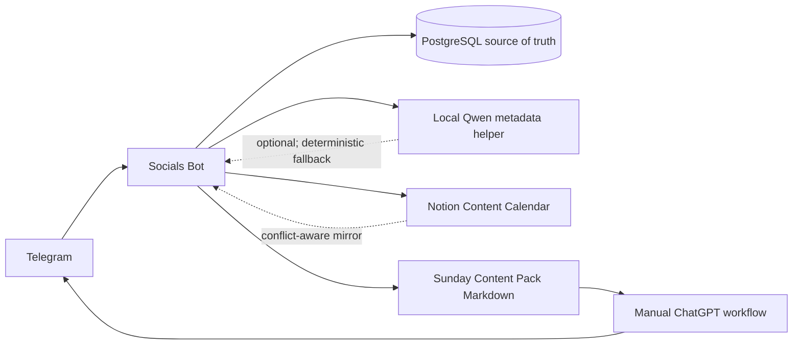
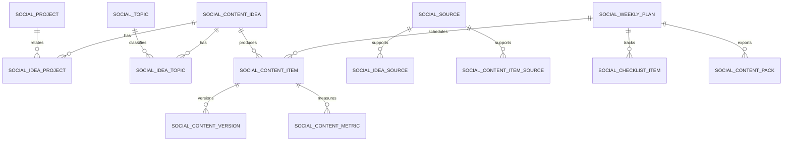
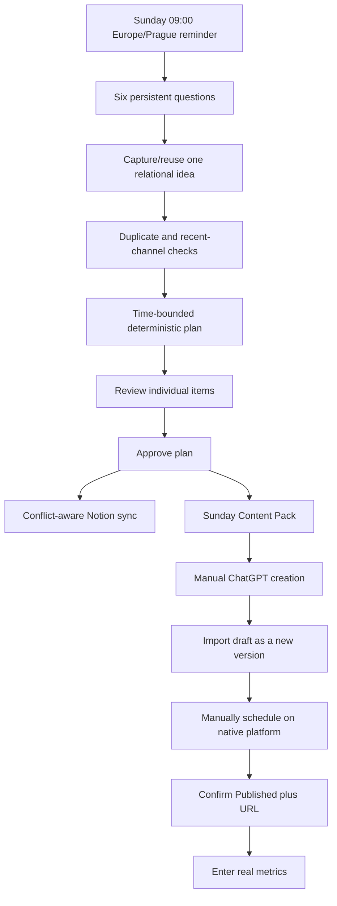

# Socials Bot

Socials Bot is a private Czech Telegram workflow for personal-brand content planning and trend intelligence. PostgreSQL is authoritative, Telegram is the interaction layer, Notion is an optional editorial mirror, and ChatGPT remains a manual high-quality writing step. The bot never publishes to LinkedIn, Instagram, the website, or a newsletter. Contacts, business cards, events, and follow-ups belong to the separate [Networking Bot](../networking-bot/README.md).

## Architecture



The main service boundaries are:

- `SocialsStore`: ownership-scoped persistence, transactions, versions, plans, reminders, and external identities.
- `SocialsService`: idea capture, deterministic planning, pack export, analytics, and optional Notion sync.
- `LightweightIdeaClassifier`: deterministic Czech keyword/project matching with a small, schema-validated Qwen request as an optional enhancement.
- `SocialsScheduler`: idempotent Sunday planning and daily trend jobs.
- `SocialNotionSync`: stable page identities, local hashes, Notion imports, and two-sided conflict detection.

## Relational model



Projects marked `PRIVATE` or `CONFIDENTIAL` are excluded from ChatGPT prompts and Notion project labels. Content versions are append-only. A scheduled timestamp never changes a content item to `PUBLISHED`; publication requires a manual status change with a URL.

## Telegram commands

| Command                   | Behavior                                                                   |
| ------------------------- | -------------------------------------------------------------------------- |
| `/start`, `/socials`      | Initialize settings and show the main inline menu.                         |
| `/help`, `/socials_help`  | Show the current complete command guide.                                   |
| `/about`                  | Explain the data model, automation, privacy, and publishing boundaries.    |
| `/socials_plan`           | Start or view the persistent six-question planning flow.                   |
| `/socials_add [text]`     | Capture one idea, relate topics/projects, and show similarity warnings.    |
| `/socials_ideas`          | Browse the idea backlog.                                                   |
| `/socials_projects`       | Browse projects or add one with its description and visibility.            |
| `/socials_topics`         | Browse reusable topics and pillars.                                        |
| `/socials_week`           | Show the next editorial week, explanations, warnings, and checklist.       |
| `/socials_pack`           | Download an idempotent versioned Markdown Content Pack.                    |
| `/socials_drafts`         | Select an item and paste/upload a new draft version.                       |
| `/socials_status`         | Show production progress; `ID STATUS [published URL]` updates it manually. |
| `/socials_history`        | Published content and URLs.                                                |
| `/socials_analytics`      | Correlation-only review and manual metric entry.                           |
| `/socials_trends`         | Latest Trend Intelligence status, report, and top opportunities.           |
| `/socials_trends run`     | Idempotent manual research run, optionally for selected sources.           |
| `/socials_trend`          | Evidence, score breakdown, scripts, posts, carousel, and production notes. |
| `/socials_trend_use`      | Relate an opportunity to the existing content-idea workflow.               |
| `/socials_trend_feedback` | Add transparent relevance, saturation, publication, or lead feedback.      |
| `/socials_trend_import`   | Import compliant CSV/JSON research for manual-only platforms.              |
| `/socials_trend_settings` | Schedule, source selection, keywords, subreddits, and report size.         |

Every command and callback passes the shared Telegram allowlist middleware. Sessions, answers, content, and callback-owned records are scoped to the Telegram user ID.

Argument examples:

```text
/socials_projects add Název | popis | PUBLIC
/socials_analytics add CONTENT_ID | impressions | likes | comments | qualified leads
/socials_trends run YOUTUBE,REDDIT
/socials_trend_feedback OPPORTUNITY_ID good praktický úhel pro lokální firmy
```

## Sunday workflow and content lifecycle



The starting cadence is Monday/Thursday LinkedIn and Tuesday/Friday Instagram. The planner reduces the number of items to the entered time budget and produces no filler when there is no suitable idea. When the monthly target is still due and enough time and unused ideas remain, it also proposes up to two blog articles and one newsletter per month.

Pillar percentages are rolling strategy metadata, not hard weekly quotas. Similarity detection combines normalized title/description tokens with project and topic overlap. It is intentionally described as a deterministic warning, not perfect semantic detection.

## Prompt generation and Content Pack

Prompts are deterministic TypeScript templates containing platform, format, Czech SME audience, business objective, angle, verified sources, public project context, output structure, CTA, restrictions, and a verification checklist. Private project context and unverified claims are excluded. Qwen never writes complete posts.

The Content Pack is versioned by content hash. Re-exporting an unchanged plan returns the same database pack instead of creating a duplicate.

## Trend Intelligence

Trend Intelligence is an evidence-preserving extension of the same Socials process, not a separate agent stack or database. Its default persisted schedule is `0 7 * * *` in `Europe/Prague`. The daily workflow is:

```mermaid
flowchart LR
  S[Permitted source adapters] --> N[Zod normalization]
  N --> D[Fingerprint deduplication]
  D --> O[Historical observations]
  O --> C[Deterministic clustering]
  C --> M[Momentum and US/CZ comparison]
  M --> SCORE[Explainable weighted score]
  SCORE --> A[Grounded Czech content adaptation]
  A --> R[Telegram daily report]
  R --> I[Existing idea backlog]
  I --> P[Existing planning and metrics]
```



Each source runs independently with `Promise.allSettled`; one unavailable provider cannot discard successful evidence. The research date plus source selection and manual-import fingerprint form the run idempotency key. Repeated platform metrics create observations, and momentum remains `UNKNOWN` until at least two comparable observations exist. Missing Czech data produces `UNCERTAIN`, never a claim that a trend is absent.

### Source integrations and access

| Source              | Automation status                           | Setup and limitations                                                                                                                                                                                                                                                                                                                                                                                                                                                                                                                                                                                                    |
| ------------------- | ------------------------------------------- | ------------------------------------------------------------------------------------------------------------------------------------------------------------------------------------------------------------------------------------------------------------------------------------------------------------------------------------------------------------------------------------------------------------------------------------------------------------------------------------------------------------------------------------------------------------------------------------------------------------------------ |
| YouTube Data API v3 | Operational with API key                    | Enable the API in a Google Cloud project and set `SOCIALS_YOUTUBE_API_KEY`. Keyword discovery runs for `US` and `CZ`, then `videos.list` adds available statistics. `regionCode` affects discovery; it does not prove viewer geography. Searches are capped by `SOCIALS_YOUTUBE_MAX_SEARCHES_PER_RUN` and identical requests are cached for six hours. See the official [getting-started](https://developers.google.com/youtube/v3/getting-started), [search.list](https://developers.google.com/youtube/v3/docs/search/list), and [quota](https://developers.google.com/youtube/v3/determine_quota_cost) documentation. |
| Reddit Data API     | Operational with approved OAuth credentials | Configure the client ID, secret, and an identifying user agent. Only configured communities are read, excerpts are bounded, and API failures are isolated. Access is subject to Reddit approval, limits, retention rules, and the current [Data API Terms](https://redditinc.com/policies/data-api-terms); unavailable access stays disabled rather than falling back to scraping.                                                                                                                                                                                                                                       |
| Bluesky AppView     | Operational without credentials             | `app.bsky.feed.searchPosts` searches configured phrases, paginates within the configured cap, applies a lookback window, and records public author/timestamp plus likes, replies, reposts, and quote metadata. The default is `https://public.api.bsky.app`; see the official [searchPosts lexicon](https://github.com/bluesky-social/atproto/blob/main/lexicons/app/bsky/feed/searchPosts.json).                                                                                                                                                                                                                        |
| Hacker News         | Operational without credentials             | The official [Firebase API](https://github.com/HackerNews/API) reads configured `top`, `new`, and/or `best` story lists, fetches items with bounded concurrency, filters by profile keywords, skips dead/deleted/non-story items, and caches item responses for ten minutes. The report preserves both the article and HN discussion URL.                                                                                                                                                                                                                                                                                |
| Mastodon            | Operational where instances expose trends   | Public [tags, statuses, and links trend endpoints](https://docs.joinmastodon.org/methods/trends/) are queried independently across every configured instance. HTML is stripped, exact trends are deduplicated across instances, and `401`/`403` endpoints are reported as unavailable without blocking public instances. No single server is treated as the whole Fediverse.                                                                                                                                                                                                                                             |
| RSS / Atom          | Operational for configured public feeds     | RSS 2.0, RDF, and Atom entries are normalized without invented engagement. Feed requests use `ETag`/`Last-Modified`, isolate malformed feeds, cap response size and redirects, and resolve every URL/redirect before fetching to reject loopback, private, link-local, and unsafe protocols. Atom parsing follows [RFC 4287](https://www.rfc-editor.org/rfc/rfc4287).                                                                                                                                                                                                                                                    |
| Google Trends       | Limited-access/manual                       | Google documents an official [Trends API alpha](https://developers.google.com/search/apis/trends), but it is not generally available. This implementation does not call undocumented endpoints. Import a permitted export with `/socials_trend_import`; `searchInterest` remains relative interest, not search volume.                                                                                                                                                                                                                                                                                                   |
| TikTok              | Manual import                               | No Creative Center scraping or anti-bot bypass exists. Import an authorized CSV/JSON export or public reference URL. Missing metrics stay missing. Official access may be added only through an appropriate authorized TikTok API.                                                                                                                                                                                                                                                                                                                                                                                       |
| Instagram           | Manual import                               | Broad public trend discovery is not inferred from the Instagram Graph API. Import authorized analytics or public references; the existing bot never fabricates reach or demographics.                                                                                                                                                                                                                                                                                                                                                                                                                                    |

Manual CSV fields are `source,title,url,region` plus optional `id,description,publishedAt,views,likes,comments,shares,searchInterest`. JSON accepts an array with the same names. `source` may be `GOOGLE_TRENDS`, `TIKTOK`, `INSTAGRAM`, or `MANUAL`. Imports are limited to 500 records and 1 MB, validate public URLs, and label supplied metrics as operator-provided.

Free-source example (RSS is disabled when its feed list is empty):

```env
SOCIALS_TREND_SOURCES=YOUTUBE,BLUESKY,HACKERNEWS,MASTODON,RSS
SOCIALS_BLUESKY_KEYWORDS=AI agents,local AI,automation
SOCIALS_HACKERNEWS_CATEGORIES=top,new,best
SOCIALS_MASTODON_INSTANCES=https://mastodon.social
SOCIALS_MASTODON_TREND_TYPES=tags,statuses,links
SOCIALS_RSS_FEEDS=https://hnrss.org/frontpage
```

After deploying the migration and restarting `socials-bot`, run `/socials_trends run` from an allowed Telegram account. Existing profiles keep their persisted source selection; use the Trend Intelligence source settings in Telegram to enable newly added providers or recreate/update the profile selection.

Source failures now include a bounded `Diagnostika zdrojů` section. For a YouTube `403`, it distinguishes common Google reasons such as exhausted quota, an invalid key, or a disabled API. Credential-free research can be forced with `/socials_trends run BLUESKY,HACKERNEWS,MASTODON`; the same research date and source set intentionally returns the cached idempotent report.

### Scoring and learning

The initial deterministic score is `US momentum 25% + Czech opportunity 25% + audience relevance 20% + business potential 15% + content feasibility 10% + evidence quality 5%`. Every factor is `0..100`; the weighted opportunity score and evidence confidence are separate. Engagement is log-normalized with provider-specific weights, recency affects momentum, and velocity is calculated only from repeated observations of the same signal. Cross-provider confirmation improves evidence quality; canonical-URL duplicates do not count twice. Missing observations reduce confidence rather than automatically turning a potentially useful topic into a low score. Telegram settings persist per operator and the weights are stored as configuration for future editing.

Feedback (`relevant`, `not_relevant`, `saturated`, `good`, `published`, `leads`) applies a small bounded adjustment to future audience relevance. Published Socials items and their manual metrics remain connected through the converted content idea. Reports describe associations only and never claim that a trend caused engagement or leads.

Qwen receives bounded structured evidence with explicit prompt-injection instructions and Zod-validated output. It interprets why a topic may matter and produces an original Czech concept, three hooks, a 30–60 second script, LinkedIn post, carousel, CTA, production guidance, and claims to verify. If Qwen is disabled or invalid, a conservative deterministic concept is produced. Neither path claims personal implementation or customer results without project evidence.

### Synthetic report example

The following is **synthetic documentation data**, never a production seed:

```text
🔭 Trend Intelligence · 2026-10-14
Čerstvost dat: 2026-10-14T05:00:00.000Z
Zdroje: YOUTUBE=ACTIVE, REDDIT=ACTIVE

1. Jak ověřit AI telefonního asistenta v malé české firmě
Platformy: YOUTUBE, REDDIT
US momentum: rychle rostoucí
Český trh: časná česká příležitost
Skóre: 78/100 · jistota 61/100
Chybějící data: delší česká historie
```

Estimated additional infrastructure cost is approximately zero when using the existing PostgreSQL, scheduler, Telegram bot, local Ollama, and provider allocations already granted to the operator. API availability and quota policies can change; no provider is described as unlimited or guaranteed free.

## Notion setup and conflict policy

Share a parent Notion page with the integration, then run locally from the repository:

```bash
NOTION_API_KEY=ntn_... \
NOTION_PARENT_PAGE_ID=... \
pnpm --filter @watcher/socials-bot notion:setup
```

Copy the printed value into `NOTION_SOCIALS_DATA_SOURCE_ID`. Configure both it and `NOTION_API_KEY`, or leave both empty. Approval performs an idempotent sync using `SocialExternalSync`.

Conflict policy:

- Local-only changes update the existing Notion page.
- Notion-only edits to Draft, Final Content, Status, dates, and published URL are imported as new local versions where applicable.
- If both sides changed since the last successful sync, status becomes `CONFLICT` and neither side is overwritten.
- Notion failures remain retryable and never roll back the authoritative local plan.

Notion is a practical editorial mirror, not a duplicate of every join table. Projects/topics are rendered as labels while their real relations remain in PostgreSQL.

## Environment

Start with [`deploy/presets/socials-bot.env.example`](../../deploy/presets/socials-bot.env.example).

| Variable                                          | Required          | Purpose                                                       |
| ------------------------------------------------- | ----------------- | ------------------------------------------------------------- |
| `DATABASE_URL`                                    | Yes               | Shared PostgreSQL database.                                   |
| `SOCIALS_TELEGRAM_TOKEN`                          | Yes               | Dedicated bot token.                                          |
| `TELEGRAM_ALLOWED_USER_IDS`                       | Yes               | Authorized Telegram users.                                    |
| `OLLAMA_URL`, `OLLAMA_MODEL`                      | When Qwen enabled | Existing local Qwen endpoint/model.                           |
| `SOCIALS_OLLAMA_ENABLED`                          | No                | Default `true`; set `false` for deterministic-only planning.  |
| `NOTION_API_KEY`, `NOTION_SOCIALS_DATA_SOURCE_ID` | No, paired        | Content Calendar synchronization.                             |
| `SOCIALS_TIMEZONE`                                | No                | Default `Europe/Prague`.                                      |
| `SOCIALS_SUNDAY_REMINDER_TIME`                    | No                | Default `09:00`.                                              |
| `SOCIALS_SCHEDULER_INTERVAL_MS`                   | No                | Durable-job polling, default 30000.                           |
| `SOCIALS_TRANSCRIPTION_URL`                       | No                | OpenAI-compatible transcription endpoint.                     |
| `SOCIALS_TRANSCRIPTION_API_KEY`                   | No                | Optional transcription credential.                            |
| `SOCIALS_TRENDS_ENABLED`                          | No                | Enables persisted daily research, default `true`.             |
| `SOCIALS_TRENDS_SCHEDULE`                         | No                | Cron schedule, default `0 7 * * *`.                           |
| `SOCIALS_TRENDS_REPORT_SIZE`                      | No                | Credible opportunities per report, default `5`, maximum `10`. |
| `SOCIALS_TREND_SOURCES`                           | No                | Initial comma-separated automated sources.                    |
| `SOCIALS_TREND_HTTP_TIMEOUT_MS`                   | No                | External-source timeout, default `20000`.                     |
| `SOCIALS_YOUTUBE_API_KEY`                         | For YouTube       | Server-only YouTube Data API v3 key.                          |
| `SOCIALS_YOUTUBE_MAX_SEARCHES_PER_RUN`            | No                | Hard per-run search cap, default `8`.                         |
| `SOCIALS_REDDIT_CLIENT_ID`                        | For Reddit        | Approved Reddit OAuth client ID.                              |
| `SOCIALS_REDDIT_CLIENT_SECRET`                    | For Reddit        | Approved Reddit OAuth client secret.                          |
| `SOCIALS_REDDIT_USER_AGENT`                       | For Reddit        | Required identifying application/user agent.                  |
| `SOCIALS_BLUESKY_API_URL`                         | No                | Public AppView base URL.                                      |
| `SOCIALS_BLUESKY_KEYWORDS`                        | No                | Extra comma-separated searches; profile keywords also apply.  |
| `SOCIALS_BLUESKY_MAX_POSTS`                       | No                | Per-run post cap, default `50`.                               |
| `SOCIALS_BLUESKY_LOOKBACK_HOURS`                  | No                | Search lookback, default `168`.                               |
| `SOCIALS_HACKERNEWS_API_URL`                      | No                | Official Firebase API base URL.                               |
| `SOCIALS_HACKERNEWS_CATEGORIES`                   | No                | Any of `top,new,best`.                                        |
| `SOCIALS_HACKERNEWS_MAX_STORIES`                  | No                | Per-run item cap, default `100`.                              |
| `SOCIALS_MASTODON_INSTANCES`                      | No                | Comma-separated public instance base URLs.                    |
| `SOCIALS_MASTODON_TREND_TYPES`                    | No                | Any of `tags,statuses,links`.                                 |
| `SOCIALS_MASTODON_MAX_ITEMS`                      | No                | Result cap, default `50`.                                     |
| `SOCIALS_RSS_FEEDS`                               | For RSS           | Comma-separated public RSS/Atom feed URLs.                    |
| `SOCIALS_RSS_MAX_ITEMS_PER_FEED`                  | No                | Per-feed entry cap, default `30`.                             |

Cadence and content pillars are persisted per operator in `social_settings`; infrastructure secrets remain environment-only.

## Development and deployment

```bash
pnpm install --frozen-lockfile
pnpm db:generate
DATABASE_URL=postgresql://... pnpm db:deploy
pnpm --filter @watcher/socials-bot typecheck
pnpm --filter @watcher/socials-bot build
pnpm --filter @watcher/socials-bot dev
```

Production uses the shared immutable image and the `socials-bot` Compose service. Put secrets only in the VPS secret source and render `deploy/runtime/socials-bot.env` with `deploy/render-env.sh`.

Manual smoke test:

1. Open `/socials` from an allowed account.
2. Add a public and private project, then `/socials_add` an idea.
3. Complete `/socials_plan`, approve the plan, and toggle a checklist item.
4. Download `/socials_pack`, generate content manually, and import it through `/socials_drafts`.
5. Change the item to `SCHEDULED`, then confirm `PUBLISHED` with its real URL.
6. Add real metrics and inspect `/socials_analytics`.
7. Restart the container during a planning question and confirm the next answer resumes the persisted session.
8. Configure one permitted trend source, run `/socials_trends run`, open a detail, provide feedback, and convert it with `/socials_trend_use`.
9. Import a small synthetic local CSV through `/socials_trend_import`; confirm the rows are labelled as manually supplied and are not duplicated on retry.
10. Enable `BLUESKY,HACKERNEWS,MASTODON,RSS`, run `/socials_trends run`, and confirm one unavailable provider does not suppress the other source results.

## Known limitations

- No autonomous publishing or email sending is implemented.
- Qwen classification is deliberately lightweight and its failure does not block capture or planning.
- Notion rich-text properties have provider limits; very large drafts remain authoritative in PostgreSQL even if Notion cannot represent every byte.
- Analytics are manual and show association, not causal attribution.
- Native website deployment and newsletter-provider campaigns are outside this version.
- Google Trends automation needs official alpha access; TikTok and broad Instagram discovery remain manual-only rather than using unsupported scraping.
- Upstream availability, quotas, and terms remain provider-controlled. Bluesky search and Mastodon trends are public endpoints but may rate-limit or be disabled; a failed adapter is shown without blocking other sources.
- Bluesky, Hacker News, Mastodon, and generic RSS do not provide verified audience geography, so their signals are `GLOBAL`; they strengthen topic discovery and cross-provider evidence but do not fabricate US/Czech reach.
- Momentum needs repeated observations. The first successful day normally reports unknown momentum and lower confidence.
- Telegram is the project-wide UI by design; “Trend Explorer,” detail, settings, and content actions are Telegram commands and inline keyboards rather than a new web dashboard.
