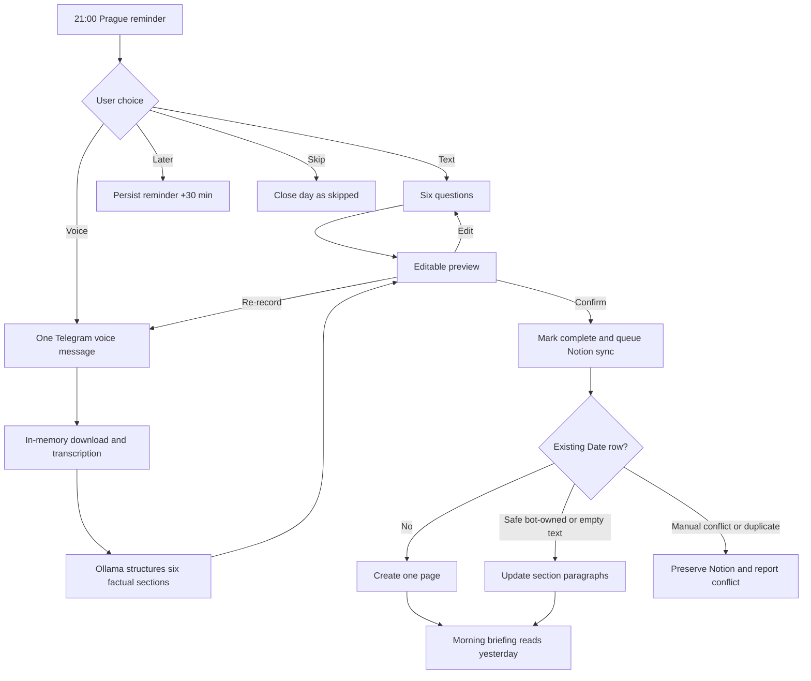

# Telegram Evening Journal

The briefing bot owns a private, Czech-language evening reflection flow. It uses the existing Telegram authorization middleware, PostgreSQL, Ollama, and Notion journal database. It does not introduce a second bot or a second journal data model.

## User flow

At `21:00` in `Europe/Prague`, each onboarded private chat receives:

> 🌙 Je čas na večerní reflexi.
>
> Pojďme si krátce projít dnešní den. Zabere to jen pár minut.

The buttons are `📝 Začít reflexi`, `🎙️ Hlasová reflexe`, `⏰ Připomenout později`, and `⏭️ Dnes vynechat`. Postponement schedules one reminder 30 minutes later. Completion or skipping closes that calendar day and prevents another reminder.



Text mode asks these exact sections in order:

1. `🌤️ Co jsem dnes zažil a udělal?`
2. `😊 Co mi dnes udělalo radost?`
3. `🧩 Co se nepovedlo a proč?`
4. `📚 Co nového jsem se naučil?`
5. `🔄 Co bych příště udělal jinak?`
6. `🎯 Jaká je jedna priorita na zítřek?`

Each answer can be text or a voice reply. Users can go back, skip an answer, cancel, or select an individual section from the preview for editing. Commands are never treated as journal answers.

Commands:

- `/journal` starts or resumes the latest unfinished session, including one continued after midnight.
- `/journal_status` shows date, progress, lifecycle state, and Notion sync state.
- `/journal_cancel` cancels the active interaction without deleting saved answers.
- `/journal_reminder_test` sends the same reminder immediately for end-to-end testing without waiting until 21:00.

## Persistence and idempotency

`journal_sessions` is unique on briefing settings, Telegram user, and journal date. It stores the interaction mode, current question, answers, transcript/draft, reminder and lease timestamps, confirmation state, Notion page identity, last synchronized answers, retry state, and errors. This makes restarts safe and isolates each authorized user.

Reminder claims use a PostgreSQL advisory lock and a short lease. A successful Telegram delivery is acknowledged once; failed delivery releases the lease. Missed reminders remain deliverable for six hours. Notion failures use bounded exponential backoff and retain the confirmed local entry.

The Notion `Date` property is authoritative, so a session started before midnight can finish afterward without moving to the next day. Before writing, the repository queries the date and rejects duplicate pages. It only replaces an empty section, identical content, or content matching the bot's last synchronized snapshot. Other text is considered a manual edit and is preserved as a conflict.

## Configuration

```dotenv
JOURNAL_ENABLED=true
JOURNAL_REMINDER_TIME=21:00
JOURNAL_TIMEZONE=Europe/Prague

NOTION_API_KEY=<internal-integration-secret>
NOTION_JOURNAL_DATA_SOURCE_ID=<data-source-id>
NOTION_API_VERSION=2026-03-11

# Required only for voice messages; may point to a trusted local Whisper server.
JOURNAL_TRANSCRIPTION_URL=http://host.docker.internal:8000/v1/audio/transcriptions
JOURNAL_TRANSCRIPTION_MODEL=whisper-1
JOURNAL_TRANSCRIPTION_API_KEY=
```

The Notion database needs `Name` (title), `Date` (date), and the six headings documented in the app README. Share the database with the integration and grant read, insert, and update content capabilities. The morning briefing reads the same confirmed page on the next Prague morning; if it is missing or unavailable, the briefing continues without journal context.

## Privacy and security

- Every command, callback, text answer, and voice message passes the existing Telegram user-ID allowlist.
- Callback lookup additionally requires the same chat and Telegram user that owns the session.
- Journal content, transcripts, bot tokens, and Notion credentials are not logged.
- Telegram audio is downloaded into memory, bounded to 20 MB, sent to the configured transcription endpoint, and discarded. Audio bytes are never stored in PostgreSQL or on disk.
- The transcript is stored only while it is required for restart-safe review and retry, then removed after successful Notion synchronization. Cancellation deliberately preserves progress.
- Ollama receives an explicit untrusted-content prompt and may not invent missing facts. The user must confirm the preview before any Notion write.

## Operations and troubleshooting

Apply the committed Prisma migration before rollout, then use `/journal_status` to distinguish interaction state from sync state. `FAILED` means local data is safe and the scheduler will retry. `CONFLICT` means a Notion section or duplicate date needs human resolution; the bot does not overwrite it. If voice mode says transcription is unavailable, configure `JOURNAL_TRANSCRIPTION_URL` or use the complete text flow. If no reminder arrives, verify onboarding is complete, `JOURNAL_ENABLED`, server time, the Prague timezone setting, and Telegram delivery logs.

Useful checks:

```bash
pnpm --filter @watcher/briefing-bot notion:check
pnpm --filter @watcher/briefing-bot typecheck
pnpm exec vitest run apps/briefing-bot/src/__tests__/evening-journal.test.ts
```
